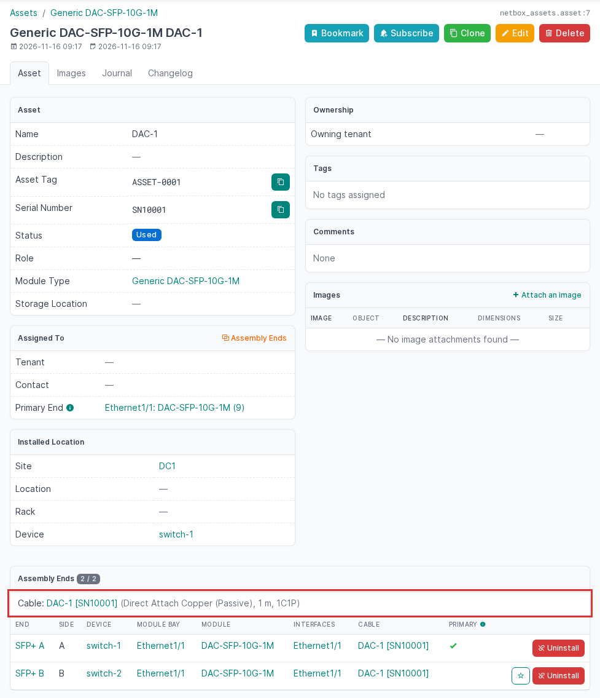

# NetBox Assets

A [NetBox](https://github.com/netbox-community/netbox) plugin for simple asset
tracking: keep a record of hardware (devices, modules and racks), and of 
**cable assemblies** (DAC, AOC and breakout cables) as single items.

> **This project is a stripped-down fork of
> [netbox-inventory](https://github.com/ArnesSI/netbox-inventory)** by Arnes.
> It is based on upstream commit
> [`e749f6f`](https://github.com/ArnesSI/netbox-inventory/commit/e749f6fd0aa2494746218537deb5c8727a0fe04a)
> (v2.7.0). All credit for the original design and code goes to the upstream
> authors. If you need the full feature set (inventory item types and groups,
> suppliers, purchases, deliveries, warranty tracking, audit flows), use the
> original plugin.

## What problems it solves

### 1. Hardware that is not installed

NetBox documents what is installed in your network. A module exists in NetBox
only while it is installed in a module bay: when a transceiver, a line card or
a power supply is removed, its module is deleted, and its serial number and
asset tag are gone with it. The same applies to a device or a rack that is
taken out of service.

netbox-assets keeps such hardware as an **asset**: what it is (a device type,
module type or rack type), its serial number and asset tag, its status and
where it is stored. The hardware can be reused later: when it is installed
again, you assign the asset to the device, module or rack that represents it
in NetBox, and its serial number and asset tag are still there.

### 2. DAC, AOC and breakout cables as one item

A DAC cable is one physical item with one serial number. In NetBox it is two
modules, one in each port like a transceiver, and a cable between their
interfaces; a breakout cable is five modules. Nothing ties these objects
together, and the serial number of the cable has no place.

netbox-assets keeps the cable assembly as **one asset** with its serial number
and asset tag. Its ends are installed as modules in the module bays of the
ports, and when both sides are installed, the plugin creates the NetBox cable
between them, with the type and length of the product. NetBox traces this
cable like any other. See [Cable assemblies](#cable-assemblies-dac-aoc-breakout).

## Features

- Assets with name, asset tag, serial number, status, role, description,
  comments, tags, custom fields and images.
- Each asset has exactly one hardware type: a device type, a module type or a
  rack type.
- Assign an asset to a device, module or rack, reassign it or unassign it.
- Cable assemblies (DAC, AOC, breakout cables): one asset whose ends are
  installed as separate modules, with a traceable NetBox cable created by the
  plugin, see
  [Cable assemblies](#cable-assemblies-dac-aoc-breakout).
- Create a new device, module or rack directly from an asset.
- Storage location, tenant, owning tenant and contact for each asset.
- Automatic status: `stored` when an asset is unassigned, `used` when it is
  assigned (configurable).
- Optional synchronization of serial number and asset tag between an asset and
  the hardware it is assigned to.
- Bulk add with an asset tag pattern, for example `ASSET-[001-010]`.
- Bulk import, export, edit and delete.
- Hierarchical asset roles (for example Optics → SFP) with cumulative asset
  counts.
- Asset information on Device, Module and Rack pages, and asset counts on
  Site, Location, Rack, Tenant, Contact and Manufacturer pages.
- Global search, REST API and GraphQL API.

## Usage

1. **Create an asset.** In *Assets → Assets*, click *Add* and choose the
   hardware type (a device type, module type or rack type). Fill in the serial
   number, asset tag, storage location and so on. This form describes *what*
   the hardware is. It does not link the asset to a particular device.
2. **Assign the asset to hardware.** Use one of these buttons:
   - *Edit Assignment* in the *Assigned To* panel on the asset page;
   - *Edit Assignment* in the *Asset* panel on a device, module or rack page;
   - *Create Device* (or *Create Module*, *Create Rack*) on the asset page, to
     create the hardware and assign the asset in one step.

   When an asset is assigned, its status changes to `used`. When it is
   unassigned, its status changes to `stored` (see
   [Settings](#settings)).

Assets are displayed as `<manufacturer> <model> <name>`, for example
`Cisco ASR edge-01`, or as `<manufacturer> <model>` when the asset has no
name. Unnamed assets of the same model look the same in lists and selection
fields, so give assets a name if you need to tell them apart.

## Cable assemblies (DAC, AOC, breakout)

A cable assembly is an asset whose module type has a **cable assembly
profile**, a NetBox Module Type Profile that describes the topology, for
example `DAC SFP+ - SFP+`. Each product (for example each length) is a module
type of this profile, and each physical cable is an asset with its own serial
number.

On the asset page, the *Assembly Ends* panel lists the ends of the cable. You
install each end in the module bay of a port; the plugin creates the module
of the end there, and when ends on both sides are installed, it creates the
NetBox cable between their interfaces, with the cable type and length of the
module type. The cable is traced like any other NetBox cable.



**[Cable assemblies guide](https://github.com/Maksym-Ototiuk/netbox-assets/blob/main/docs/cable-assembly-profiles.md)**:

- [DAC step by step with screenshots](https://github.com/Maksym-Ototiuk/netbox-assets/blob/main/docs/cable-assembly-profiles.md#step-by-step-a-10g-sfp-dac-1-m):
  import a profile, create the module type of a 10G SFP+ DAC, create the
  asset and install its ends in two switches;
- [breakout step by step with screenshots](https://github.com/Maksym-Ototiuk/netbox-assets/blob/main/docs/cable-assembly-profiles.md#step-by-step-a-40g-qsfp-to-4x-10g-sfp-breakout-cable-3-m):
  the side A and side B module types of a 40G QSFP+ to 4x 10G SFP+ breakout
  cable, its installation in a switch and four servers, and the trace of
  each channel;
- [profiles for import](https://github.com/Maksym-Ototiuk/netbox-assets/blob/main/docs/cable-assembly-profiles.md#profiles-for-import)
  for 10G, 25G and 100G DAC, 100G AOC and 40G and 100G breakout cables, with
  module types;
- [reference](https://github.com/Maksym-Ototiuk/netbox-assets/blob/main/docs/cable-assembly-profiles.md#reference):
  rules for profiles, module types and ends, the cable, the primary end,
  writing your own profile and troubleshooting.

## Suppliers, warranty and other information

netbox-assets stores only what identifies the hardware and where it is. For
anything else, such as the supplier, the purchase order, the purchase date,
the price or the end of warranty, use NetBox
[custom fields](https://netboxlabs.com/docs/netbox/customization/custom-fields/)
on assets:

1. Go to *Customization → Custom Fields* and click *Add*.
2. Choose the object type **NetBox Assets > Asset**.
3. Choose a name and a type, for example:

   | Name             | Type                       | Purpose |
   | ---------------- | -------------------------- | ------- |
   | `supplier`       | Text, or Object (Tenant)   | Who sold the hardware |
   | `order_number`   | Text                       | Purchase order |
   | `purchase_date`  | Date                       | When it was bought |
   | `warranty_end`   | Date                       | End of the warranty or support contract |

Custom fields are shown in the asset form and on the asset page, and they
work in the asset list (columns and filters), in bulk import, export and
edit, and in the REST and GraphQL API. To find assets by a custom field in
the search box of the asset list, add it to the setting
`asset_custom_fields_search_filters` (see [Settings](#settings)).

## Limitations

- **Cannot be installed together with netbox-inventory.** Both plugins define
  the same relations on NetBox core models (for example
  `Device.assigned_asset`) and the same GraphQL type names. netbox-assets
  refuses to start if `netbox_inventory` is also enabled. This is a
  deliberate simplification.
- **No data migration from netbox-inventory.** netbox-assets is meant for a
  clean installation. It ships its own fresh database migrations and does not
  read or convert netbox-inventory data.

## Compatibility

| NetBox           | netbox-assets |
| ---------------- | ------------- |
| 4.7.4 and later  | 1.2.x         |
| 4.7.2 to 4.7.3   | 1.1.x         |

NetBox 4.7 requires Python 3.12 or later, PostgreSQL 15 or later with the
`ltree` extension, and Redis 6 or later.

NetBox 4.7.0 is not supported: the database triggers that maintain
hierarchical paths could not be restored from a database dump in that release
([netbox#23130](https://github.com/netbox-community/netbox/issues/23130)).

## Installation

Activate the NetBox virtual environment and install the package:

```shell
source /opt/netbox/venv/bin/activate
pip install netbox-assets
```

To keep the plugin installed after NetBox upgrades, add it to
`local_requirements.txt`:

```shell
echo netbox-assets >> /opt/netbox/local_requirements.txt
```

Enable the plugin in `/opt/netbox/netbox/netbox/configuration.py`:

```python
PLUGINS = [
    'netbox_assets',
]

PLUGINS_CONFIG = {
    'netbox_assets': {},
}
```

Apply the database migrations, update the search index and restart NetBox:

```shell
cd /opt/netbox/netbox
python3 manage.py migrate netbox_assets
python3 manage.py reindex --lazy
sudo systemctl restart netbox netbox-rq
```

## Settings

Override the defaults in `PLUGINS_CONFIG`:

```python
PLUGINS_CONFIG = {
    'netbox_assets': {
        'used_status_name': 'used',
        'stored_status_name': 'stored',
        'sync_hardware_serial_asset_tag': True,
    },
}
```

| Setting                              | Default         | Description |
| ------------------------------------ | --------------- | ----------- |
| `used_status_name`                   | `'used'`        | Status set when an asset is assigned to a device, module or rack. |
| `used_additional_status_names`       | `[]`            | Other statuses that also mean "in use". |
| `stored_status_name`                 | `'stored'`      | Status set when an asset is unassigned. |
| `stored_additional_status_names`     | `['retired']`   | Other statuses that also mean "not in use". |
| `sync_hardware_serial_asset_tag`     | `False`         | Keep serial number and asset tag of the assigned device, module or rack in sync with the asset. The device type, module type or rack type is updated as well. |
| `asset_import_create_device_type`    | `False`         | When importing assets, create a missing manufacturer and device type. |
| `asset_import_create_module_type`    | `False`         | When importing assets, create a missing manufacturer and module type. |
| `asset_import_create_rack_type`      | `False`         | When importing assets, create a missing manufacturer and rack type. |
| `asset_import_create_tenant`         | `False`         | When importing assets, create a missing tenant (for the tenant and owning tenant fields). |
| `asset_custom_fields_search_filters` | `{}`            | Custom fields and lookups to add to the asset search filters, for example `{'asset_mac': ['icontains', 'exact']}`. |

To disable automatic status changes, set both `used_status_name` and
`stored_status_name` to `None`.

### Asset statuses

The default statuses are `stored`, `used` and `retired`. You can add your own
with the NetBox
[`FIELD_CHOICES`](https://netboxlabs.com/docs/netbox/configuration/data-validation/#field_choices)
setting:

```python
FIELD_CHOICES = {
    'netbox_assets.Asset.status+': (
        ('repair', 'In repair', 'orange'),
    ),
}
```

If you add statuses, also review `used_additional_status_names` and
`stored_additional_status_names`.

## REST API and GraphQL

REST API endpoints:

| Endpoint                                | Description |
| --------------------------------------- | ----------- |
| `/api/plugins/assets/assets/`           | Assets |
| `/api/plugins/assets/asset-roles/`      | Asset roles |
| `/api/plugins/assets/assembly-ends/`    | Installed ends of cable assemblies |
| `/api/plugins/assets/dcim/devices/`     | NetBox devices with an extra `has_asset_assigned` filter |
| `/api/plugins/assets/dcim/modules/`     | NetBox modules with an extra `has_asset_assigned` filter |

Assets have the read-only fields `is_assembly` and `assembly_cable` (the
cable of a cable assembly) and the filter `is_assembly=true|false`. An end is
created with the `asset` and `module` IDs and the `label` of the end; if
`label` is empty, the first free end that matches the module type is used.
The read-only field `side` shows the side of the end.

GraphQL queries: `asset`, `asset_list`, `asset_role`, `asset_role_list`,
`assembly_end`, `assembly_end_list`. Assets have the fields `ends` and
`assembly_cable`.

Ends can also be imported in the web interface, see
[Installing ends](https://github.com/Maksym-Ototiuk/netbox-assets/blob/main/docs/cable-assembly-profiles.md#installing-ends).

## Development

The tests use the NetBox test framework. They need a NetBox 4.7 installation
with PostgreSQL and Redis, and a database user that is allowed to create the
test database. Install the plugin into the NetBox virtual environment in
editable mode (`pip install -e .`) and run:

```shell
cd /opt/netbox/netbox
python3 manage.py test netbox_assets.tests --keepdb --parallel 4
```

NetBox compares the number of database queries of list views with
`netbox_assets/tests/query_counts.json`. If you change a list view or an API
serializer on purpose, update the file (this does not work with `--parallel`):

```shell
UPDATE_QUERY_COUNTS=1 python3 manage.py test netbox_assets.tests --keepdb
```

GitHub Actions run `ruff` and the test suite against NetBox 4.7.4 on every
push and pull request.

## Version history

See [CHANGELOG.md](https://github.com/Maksym-Ototiuk/netbox-assets/blob/main/CHANGELOG.md).

## Links

- Source code and documentation: <https://github.com/Maksym-Ototiuk/netbox-assets>
- Cable assemblies guide: <https://github.com/Maksym-Ototiuk/netbox-assets/blob/main/docs/cable-assembly-profiles.md>
- Issues: <https://github.com/Maksym-Ototiuk/netbox-assets/issues>
- PyPI: <https://pypi.org/project/netbox-assets/>

## License

MIT License, see [LICENSE](https://github.com/Maksym-Ototiuk/netbox-assets/blob/main/LICENSE).

- Copyright (c) 2022 Arnes (original netbox-inventory code)
- Copyright (c) 2026 Maksym Ototiuk (changes in this fork)

You may use, copy, modify and distribute this software for any purpose. It is
provided "as is", without warranty of any kind, and the authors are not liable
for any damage caused by its use.
