# Cable assemblies (DAC, AOC, breakout)

A DAC, AOC or breakout cable is one physical item with one serial number, but
in NetBox it has several ends, and each end is plugged into a port like a
transceiver. netbox-assets keeps such a cable as **one asset**, installs its
ends as modules in the module bays of the ports, and creates the NetBox cable
between them. NetBox traces the cable like any other.

This guide walks through two examples in NetBox: a 10G SFP+ DAC cable, 1 m
long, connecting two switches, and a 40G QSFP+ to 4x 10G SFP+ breakout cable
connecting a switch to four servers. It then gives ready-to-import profiles
for common DAC, AOC and breakout cables, and the reference rules.

## Contents

- [How it works](#how-it-works)
- [Step by step: a 10G SFP+ DAC, 1 m](#step-by-step-a-10g-sfp-dac-1-m)
  - [Before you start](#before-you-start)
  - [Step 1. Import the profile](#step-1-import-the-profile)
  - [Step 2. Create the module type](#step-2-create-the-module-type)
  - [Step 3. Create the asset](#step-3-create-the-asset)
  - [Step 4. Install the ends](#step-4-install-the-ends)
  - [Step 5. Check the cable](#step-5-check-the-cable)
  - [Uninstall or move a cable assembly](#uninstall-or-move-a-cable-assembly)
- [Step by step: a 40G QSFP+ to 4x 10G SFP+ breakout cable, 3 m](#step-by-step-a-40g-qsfp-to-4x-10g-sfp-breakout-cable-3-m)
  - [What is different](#what-is-different)
  - [Devices for the example](#devices-for-the-example)
  - [Step 1. Import the breakout profile](#step-1-import-the-breakout-profile)
  - [Step 2. Create the side A and side B module types](#step-2-create-the-side-a-and-side-b-module-types)
  - [Step 3. Create the breakout asset](#step-3-create-the-breakout-asset)
  - [Step 4. Install the QSFP+ end and the SFP+ ends](#step-4-install-the-qsfp-end-and-the-sfp-ends)
  - [Step 5. Check the breakout cable](#step-5-check-the-breakout-cable)
  - [Uninstall a breakout cable](#uninstall-a-breakout-cable)
- [Profiles for import](#profiles-for-import)
- [Reference](#reference)
  - [Profiles and module types](#profiles-and-module-types)
  - [Installing ends](#installing-ends)
  - [Status, primary end and synchronization](#status-primary-end-and-synchronization)
  - [Cable](#cable)
  - [Writing your own profile](#writing-your-own-profile)
  - [Limitations](#limitations)
  - [Troubleshooting](#troubleshooting)

## How it works

| Object | What it represents | Example |
| ------ | ------------------ | ------- |
| Module type profile | The **topology** of a cable assembly: the number of ends, their names and the attributes of its module types. One profile per topology. | `DAC SFP+ - SFP+` |
| Module type with this profile | A **product**: one model, one length. | `DAC-SFP-10G-1M` |
| Asset of this module type | **One physical cable**, with its serial number and asset tag. | `DAC-1`, serial `SN10001` |
| End | One plug of the cable, installed as a **module** in the module bay of a port. | `SFP+ A` in `switch-1` / `Ethernet1/1` |
| Cable | Created by the plugin between the interfaces of the end modules when both sides are installed. | `DAC-1 [SN10001]` |

The ports follow the NetBox practice for pluggable transceivers: every port is
a **module bay**, the plug of the cable is a module installed in it, and the
module creates the interface of the port.

## Step by step: a 10G SFP+ DAC, 1 m

### Before you start

You need:

- NetBox with netbox-assets installed, see
  [Installation](../README.md#installation).
- A manufacturer for the cable, here `Generic` (*Devices → Manufacturers*).
- Two devices with a module bay for the port. In this example: `switch-1`
  and `switch-2` of the device type `Test Switch`, which has one module bay
  `Ethernet1/1` with the **position** `Ethernet1/1`.

The position matters. The interface template of the module type is named
`{module}`, and NetBox replaces `{module}` with the **position** of the module
bay (not its name). The module installed in the bay `Ethernet1/1` creates the
interface `Ethernet1/1`. A module bay without a position cannot get an end.

### Step 1. Import the profile

The profile describes the topology "SFP+ on both ends". Import it once; all
10G SFP+ DAC products of any length use it.

Go to *Devices → Module Type Profiles*, click **Import**, paste the block
below, choose the format **YAML** and click **Submit**.

```yaml
name: DAC SFP+ - SFP+
description: 10G direct attach copper cable, SFP+ on both ends
schema:
  type: object
  x-end-names:
    A: [SFP+ A]
    B: [SFP+ B]
  properties:
    side:
      type: string
      title: Assembly side
      enum: [both]
      default: both
    a_ends:
      type: integer
      title: A-side ends
      enum: [1]
      default: 1
    b_ends:
      type: integer
      title: B-side ends
      enum: [1]
      default: 1
    cable_type:
      type: string
      title: Cable type
      enum:
        - Direct Attach Copper (Passive)
        - Direct Attach Copper (Active)
    length:
      type: number
      title: Length (m)
      minimum: 0
  required: [side, cable_type, length]
```

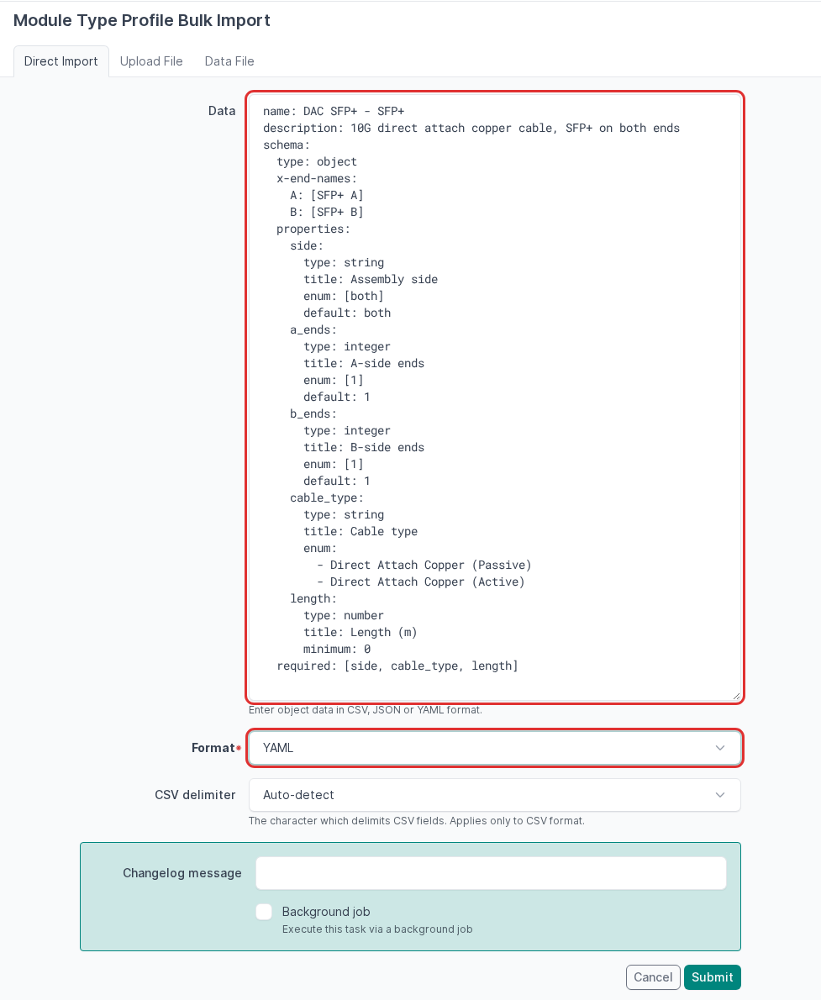

The properties of the schema become the attributes of every module type with
this profile: *Assembly side*, *A-side ends*, *B-side ends*, *Cable type* and
*Length (m)*. `x-end-names` names the two ends `SFP+ A` and `SFP+ B`.

### Step 2. Create the module type

Create one module type per product, here the 1 m cable. Go to
*Devices → Module Types* and click **Add**.

1. In **Module Type**, choose the manufacturer `Generic` and enter the model
   `DAC-SFP-10G-1M`. Part number and description are optional.

   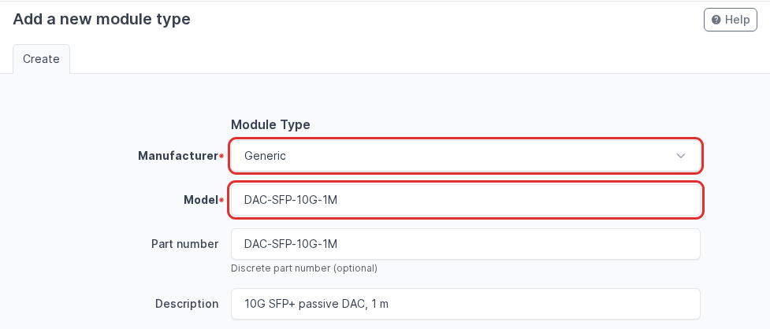

2. In **Profile & Attributes**, at the bottom of the form, choose the profile
   `DAC SFP+ - SFP+`. The form then shows the attributes of the profile:

   - **A-side ends** and **B-side ends**: `1` and `1`, fixed by the profile;
   - **Cable type**: `Direct Attach Copper (Passive)`;
   - **Length (m)**: `1`;
   - **Assembly side**: `both`, because both ends of a DAC are the same.

   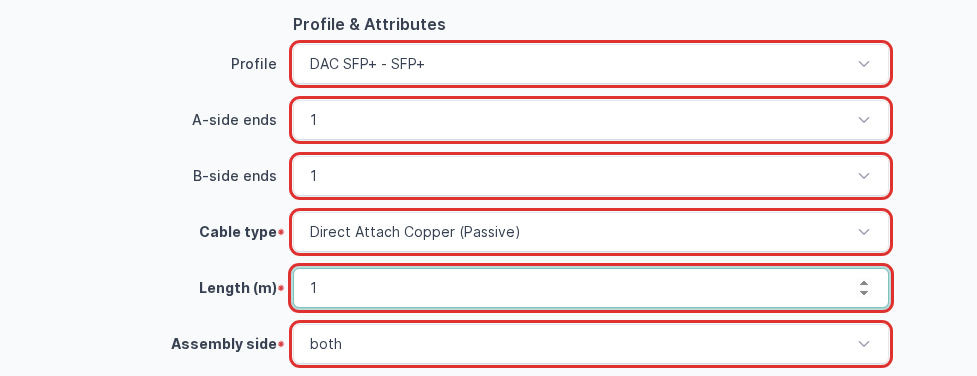

3. Click **Create**.
4. Add the interface of the end. On the page of the new module type, click
   **Add Components → Interfaces**, enter the name `{module}`, choose the type
   `SFP+ (10GE)` and click **Create**.

   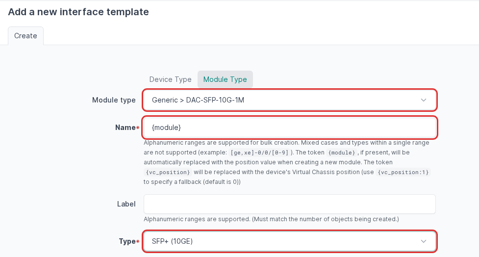

**Or import the module type** with its interface in one step: *Devices →
Module Types → Import*, format **YAML**:

```yaml
profile: DAC SFP+ - SFP+
manufacturer: Generic
model: DAC-SFP-10G-1M
part_number: DAC-SFP-10G-1M
description: 10G SFP+ passive DAC, 1 m
attribute_data:
  side: both
  a_ends: 1
  b_ends: 1
  cable_type: Direct Attach Copper (Passive)
  length: 1
interfaces:
  - name: "{module}"
    type: 10gbase-x-sfpp
```

### Step 3. Create the asset

The asset is the physical cable you hold in your hand. Go to
*Assets → Assets* and click **Add**.

- **Name** (optional): `DAC-1`. The plugin uses it in the label of the
  cable.
- **Asset Tag**: `ASSET-0001`.
- **Status**: `Stored`. The cable is not installed yet.
- **Serial Number**: `SN10001`.
- **Hardware**: open the **Module** tab and choose the module type
  `DAC-SFP-10G-1M`.

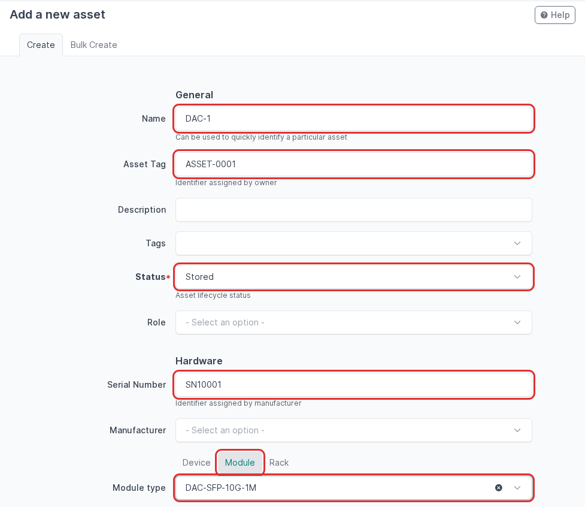

Click **Create**. The asset page has the panel **Assembly Ends** with the two
ends of the profile, `SFP+ A` and `SFP+ B`, both not installed. The cable is
created later, when ends on both sides are installed.

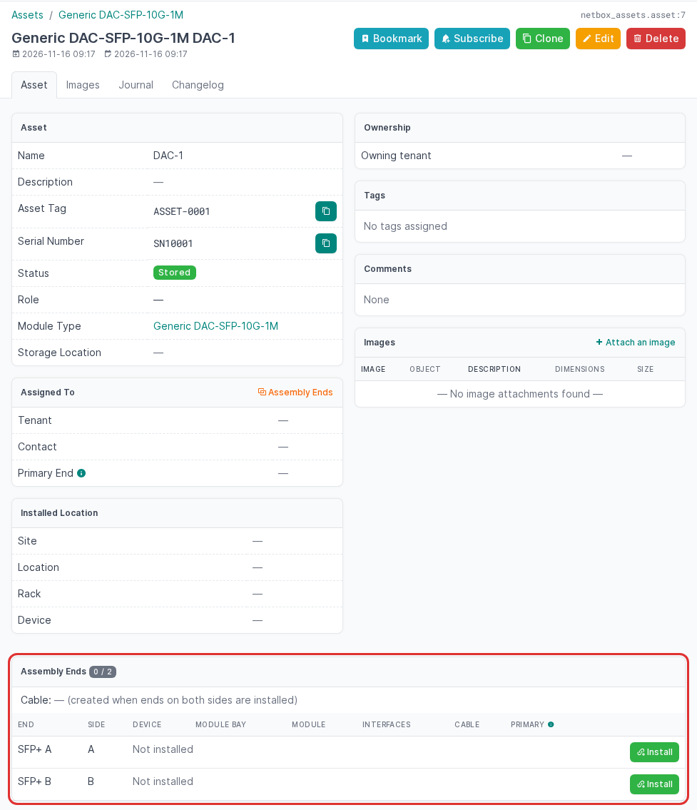

### Step 4. Install the ends

In the **Assembly Ends** panel, click **Install** next to `SFP+ A`. The
cable assembly and the end are already filled in. Choose:

- **Device**: `switch-1`;
- **Module bay**: `Ethernet1/1`;
- **Module type**: `DAC-SFP-10G-1M` is preselected. It is used to create the
  module if the module bay is empty.

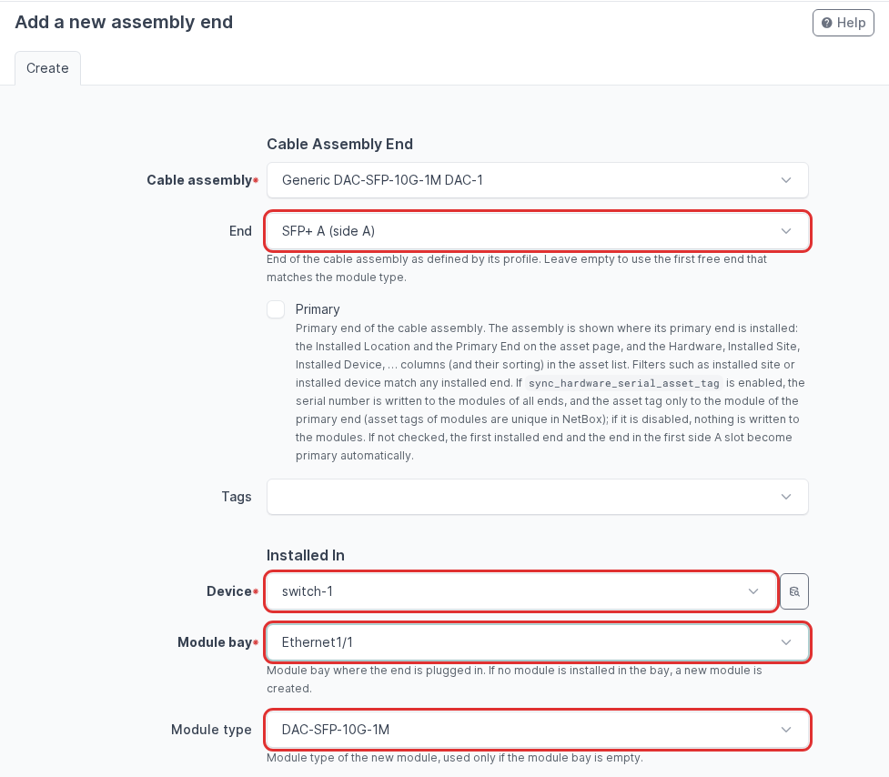

Click **Create**. The plugin creates the module `DAC-SFP-10G-1M` in the module
bay, the module creates the interface `Ethernet1/1`, and the asset becomes
`Used`.

**Install `SFP+ B` in `switch-2`, module bay `Ethernet1/1`, the same way.**

If a module is already installed in the module bay, it becomes the end
instead; it must be of the module type `DAC-SFP-10G-1M`.

### Step 5. Check the cable

When the second end is installed, the plugin creates the NetBox cable between
the interfaces of the two ends. The asset page shows it in the **Assembly
Ends** panel: `DAC-1 [SN10001]`, type `Direct Attach Copper (Passive)`, 1 m,
cable profile `1C1P`. Each end shows its device, module bay, module and
interface.

![Asset page: both ends installed and the cable DAC-1 [SN10001]](images/dac-08-asset-cable.png)

The cable is an ordinary NetBox cable. Its type and length come from the
module type, and its label from the asset name and serial number. It
connects `switch-1 Ethernet1/1` with `switch-2 Ethernet1/1`:

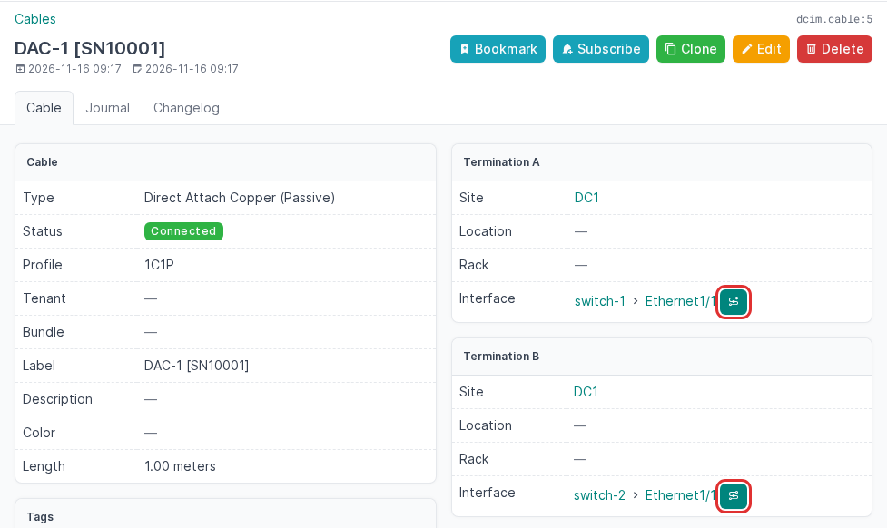

The cable **is traced** like any other cable. Click the trace button next to
an interface on the cable page, or **Trace** on the interface page:

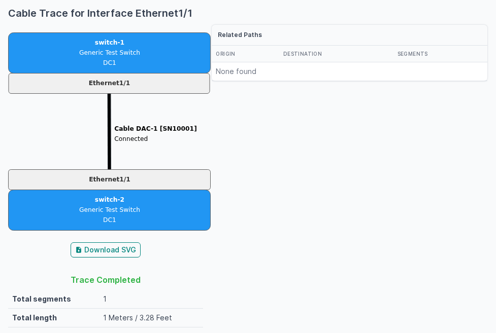

### Uninstall or move a cable assembly

- **Uninstall**: click **Uninstall** next to an end in the **Assembly Ends**
  panel. The plugin deletes the cable as soon as one side has no installed
  end. The modules stay in NetBox; delete them if the ports are empty now.
  When the last end is uninstalled, the asset becomes `Stored` again, with
  its serial number and asset tag, ready to be installed elsewhere.
- **Move**: uninstall the ends and install them in the new module bays. You
  can also move an end module to another module bay of the same device with
  NetBox; the end moves with it.

## Step by step: a 40G QSFP+ to 4x 10G SFP+ breakout cable, 3 m

### What is different

A breakout cable has one QSFP+ end on side A (`QSFP+ A`) and four SFP+ ends on
side B (`SFP+ B1` to `SFP+ B4`). The steps are the same as for the
[DAC](#step-by-step-a-10g-sfp-dac-1-m), with three differences:

- Each product needs **two module types** with the same profile and the same
  manufacturer: **side A** for the QSFP+ end and **side B** for the SFP+ ends.
  The asset uses the side A module type.
- The interface of the QSFP+ end is **channelized** into four channels. Each
  channel is a channel subinterface, and NetBox traces it to one SFP+ end.
- The plugin creates **one cable** with one termination on side A and four on
  side B, with the breakout cable profile `1C4P:4C1P breakout`.

### Devices for the example

- `switch-3` of the device type `Test Switch QSFP`, with a module bay
  `Ethernet1/49` (position `Ethernet1/49`) for the QSFP+ port;
- `server-1` to `server-4` of the device type `Test Server`, each with a
  module bay `eth0` (position `eth0`) for the SFP+ port.

As for the DAC, the module bays need a position, because the interface names
of the module types use `{module}`, see [Before you start](#before-you-start).

### Step 1. Import the breakout profile

Import the profile as in [Step 1](#step-1-import-the-profile) of the DAC guide:
*Devices → Module Type Profiles → Import*, format **YAML**:

```yaml
name: Breakout QSFP+ - 4xSFP+
description: 40G QSFP+ to 4x 10G SFP+ breakout cable
schema:
  type: object
  x-end-names:
    A: [QSFP+ A]
    B: [SFP+ B1, SFP+ B2, SFP+ B3, SFP+ B4]
  properties:
    side:
      type: string
      title: Assembly side
      enum: [A, B]
    a_ends:
      type: integer
      title: A-side ends
      enum: [1]
      default: 1
    b_ends:
      type: integer
      title: B-side ends
      enum: [4]
      default: 4
    cable_type:
      type: string
      title: Cable type
      enum:
        - Direct Attach Copper (Passive)
        - Direct Attach Copper (Active)
        - Active Optical Cabling (AOC)
    length:
      type: number
      title: Length (m)
      minimum: 0
  required: [side, cable_type, length]
```

Compared to the DAC profile, `side` offers `A` and `B` (two module types per
product), `b_ends` is `4`, and `x-end-names` names five ends.

### Step 2. Create the side A and side B module types

Import both module types in one step: *Devices → Module Types → Import*,
format **YAML**. The block has two YAML documents, separated by `---`:

```yaml
profile: Breakout QSFP+ - 4xSFP+
manufacturer: Generic
model: BRK-QSFP-4SFP-10G-3M-A
part_number: BRK-QSFP-4SFP-10G-3M
description: 40G QSFP+ to 4x 10G SFP+ passive breakout, 3 m, QSFP+ end
attribute_data:
  side: A
  a_ends: 1
  b_ends: 4
  cable_type: Direct Attach Copper (Passive)
  length: 3
interfaces:
  - name: "{module}"
    type: 40gbase-x-qsfpp
    channels: 4
  - name: "{module}:1"
    type: 10gbase-x-sfpp
    parent: "{module}"
    channel_id: 1
  - name: "{module}:2"
    type: 10gbase-x-sfpp
    parent: "{module}"
    channel_id: 2
  - name: "{module}:3"
    type: 10gbase-x-sfpp
    parent: "{module}"
    channel_id: 3
  - name: "{module}:4"
    type: 10gbase-x-sfpp
    parent: "{module}"
    channel_id: 4
---
profile: Breakout QSFP+ - 4xSFP+
manufacturer: Generic
model: BRK-QSFP-4SFP-10G-3M-B
part_number: BRK-QSFP-4SFP-10G-3M
description: 40G QSFP+ to 4x 10G SFP+ passive breakout, 3 m, SFP+ end
attribute_data:
  side: B
  a_ends: 1
  b_ends: 4
  cable_type: Direct Attach Copper (Passive)
  length: 3
interfaces:
  - name: "{module}"
    type: 10gbase-x-sfpp
```

The **side A** module type `BRK-QSFP-4SFP-10G-3M-A` has the profile
`Breakout QSFP+ - 4xSFP+` and the attributes *Assembly side* `A`, *A-side
ends* `1`, *B-side ends* `4`, the cable type and the length:

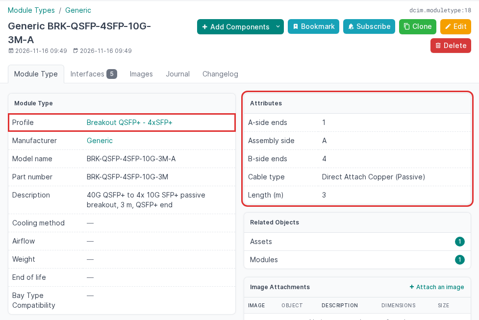

Its interfaces: the QSFP+ interface `{module}` with **4 channels**, and the
channel subinterfaces `{module}:1` to `{module}:4`, each with the parent
interface `{module}` and its channel ID. NetBox names them after the
position of the module bay: `Ethernet1/49`, `Ethernet1/49:1` and so on.

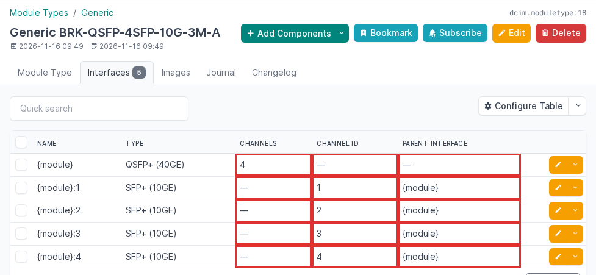

The **side B** module type `BRK-QSFP-4SFP-10G-3M-B` has the same profile,
manufacturer and attributes, except *Assembly side* `B`, and one interface
`{module}` of type `SFP+ (10GE)`.

You can also create the module types with the form, as in
[Step 2](#step-2-create-the-module-type) of the DAC guide: choose *Assembly
side* `A` or `B`, then add the interface templates. On the side A type, add
`{module}` with *Channels* `4` first, then `{module}:1` to `{module}:4` with
*Parent* `{module}` and *Channel ID* `1` to `4`.

If the side B module type is missing, the **Assembly Ends** panel of the
asset shows a warning with a **Create Module Type** button. It opens the
module type form, prefilled with the profile, the manufacturer and the
attributes.

### Step 3. Create the breakout asset

Create the asset as in [Step 3](#step-3-create-the-asset) of the DAC guide,
with the **side A** module type:

- **Name**: `BRK-1`;
- **Asset Tag**: `ASSET-0002`;
- **Status**: `Stored`;
- **Serial Number**: `SN20001`;
- **Hardware**: tab **Module**, module type `BRK-QSFP-4SFP-10G-3M-A`.

The **Assembly Ends** panel lists the five ends of the profile:

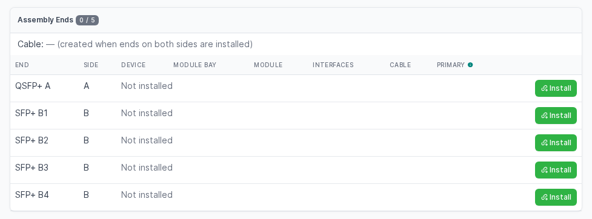

### Step 4. Install the QSFP+ end and the SFP+ ends

1. Click **Install** next to `QSFP+ A` and choose the device `switch-3`, the
   module bay `Ethernet1/49`. The side A module type is preselected, as in
   [Step 4](#step-4-install-the-ends) of the DAC guide.
2. Click **Install** next to `SFP+ B1` and choose the device `server-1`, the
   module bay `eth0`. The Install form preselects the **side B** module type
   `BRK-QSFP-4SFP-10G-3M-B`:

   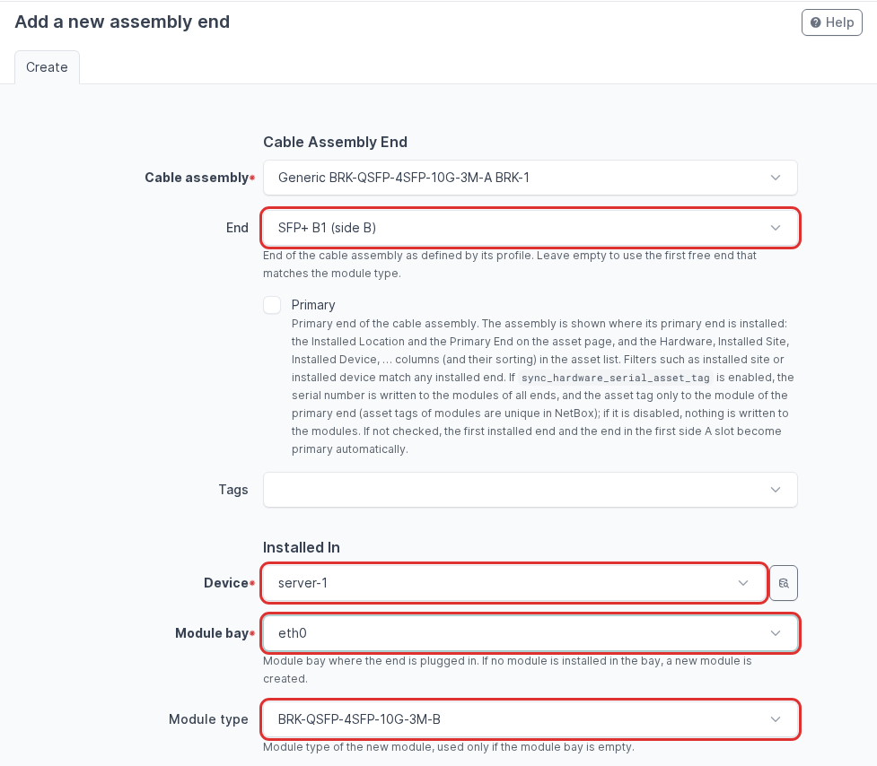

3. **Install `SFP+ B2`, `SFP+ B3` and `SFP+ B4` in `server-2`, `server-3`
   and `server-4` the same way.**

> [!NOTE]
> The form preselects the side B module type only if it is the only one with
> this profile and manufacturer. If the manufacturer has several breakout
> products with this profile (for example a 1 m and a 3 m cable), each has its
> own side B module type; choose the one of your product.

The plugin creates the cable as soon as the QSFP+ end and the first SFP+ end
are installed, and adds each further SFP+ end to it. The ends can be
installed in any order.

If only some SFP+ ends are used, install them in the order B1, B2, …. NetBox
assigns the connectors of the cable by the order of the terminations. While
the installed side B ends have a gap (here `SFP+ B1` and `SFP+ B3` without
`SFP+ B2`), the cable has no cable profile and the panel shows a warning:

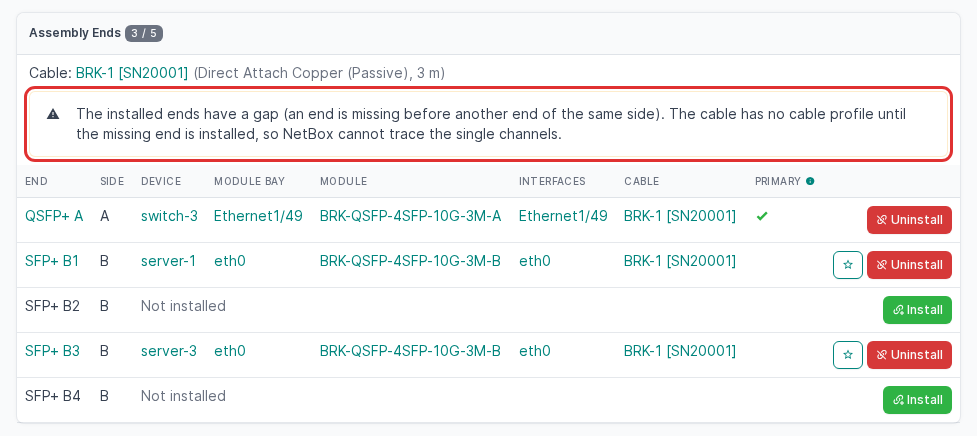

The warning disappears when the missing end is installed.

### Step 5. Check the breakout cable

With all five ends installed, the **Assembly Ends** panel shows the cable
`BRK-1 [SN20001]`: type `Direct Attach Copper (Passive)`, 3 m, cable profile
`1C4P:4C1P breakout`.

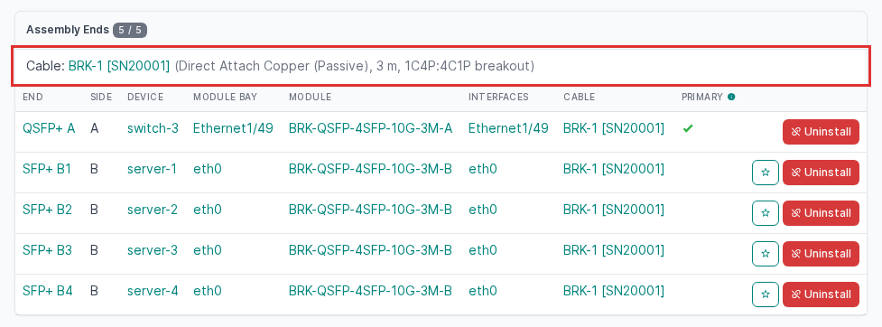

On the cable page, termination A is the QSFP+ interface of `switch-3`, and
termination B the four server interfaces, in the order `SFP+ B1` to
`SFP+ B4`:

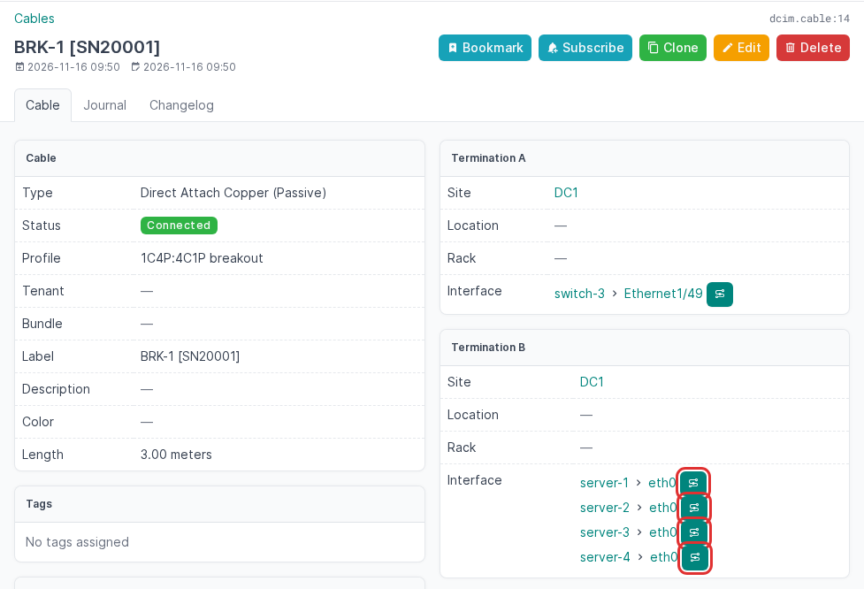

The interfaces of `switch-3` show the connection of each channel:
`Ethernet1/49:1` to `server-1 eth0`, `Ethernet1/49:2` to `server-2 eth0`, and
so on.

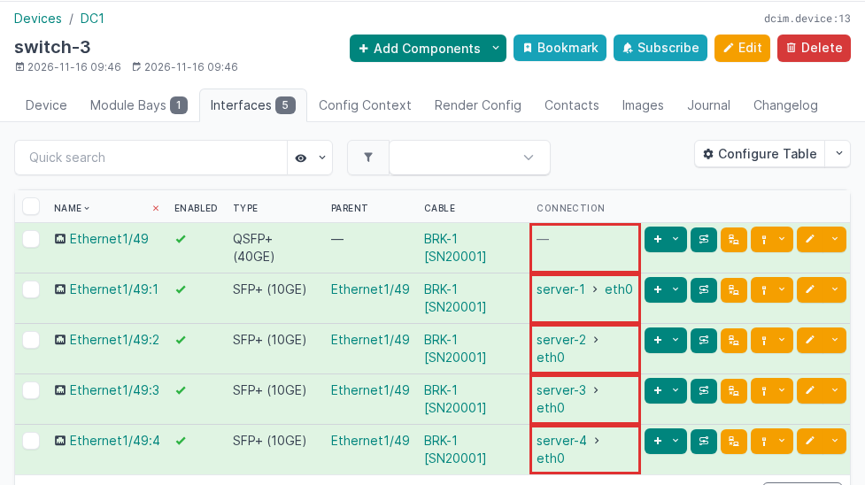

**Trace** a channel subinterface (for example `Ethernet1/49:2`) or a server
interface to see the path through the breakout cable:

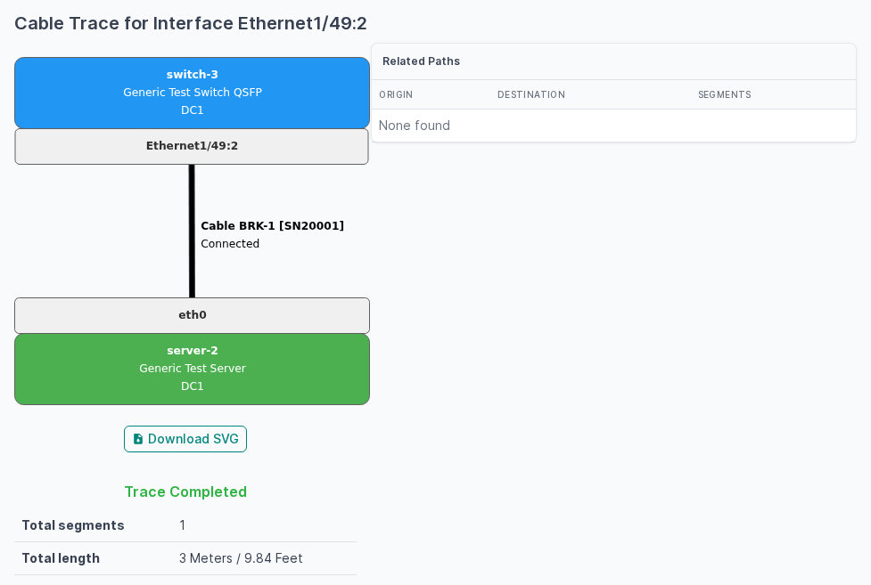

The trace of the parent interface `Ethernet1/49` shows *No paths found*: in
NetBox the paths run through its channel subinterfaces.

### Uninstall a breakout cable

- Uninstalling an SFP+ end removes only this end from the cable.
- Uninstalling the QSFP+ end, or the last SFP+ end, deletes the cable.
- The modules stay in NetBox, and the asset becomes `Stored` when its last
  end is uninstalled, as for a DAC.

## Profiles for import

Ready-to-use profiles for six common DAC, AOC and breakout cables. Each
profile describes a topology, not a product: import it once, then create one
module type (or one pair of module types for a breakout cable) per product,
for example per length.

| # | Profile | Speed | Ends | Cable types |
| - | ------- | ----- | ---- | ----------- |
| 1 | `DAC SFP+ - SFP+` | 10G | `SFP+ A`, `SFP+ B` | DAC passive or active |
| 2 | `DAC SFP28 - SFP28` | 25G | `SFP28 A`, `SFP28 B` | DAC passive or active |
| 3 | `DAC QSFP28 - QSFP28` | 100G | `QSFP28 A`, `QSFP28 B` | DAC passive or active |
| 4 | `AOC QSFP28 - QSFP28` | 100G | `QSFP28 A`, `QSFP28 B` | AOC |
| 5 | `Breakout QSFP+ - 4xSFP+` | 40G to 4x 10G | `QSFP+ A`, `SFP+ B1` to `SFP+ B4` | DAC passive or active, AOC |
| 6 | `Breakout QSFP28 - 4xSFP28` | 100G to 4x 25G | `QSFP28 A`, `SFP28 B1` to `SFP28 B4` | DAC passive or active, AOC |

- **Profiles:** *Devices → Module Type Profiles → Import*, format **YAML**.
  Paste one profile, or several profiles separated by a line `---`. A
  profile that already exists cannot be imported again (the names are
  unique).
- **Module types:** *Devices → Module Types → Import*, format **YAML**. Import
  the profile and create the manufacturer (here `Generic`) first, and replace
  the model, part number, length and cable type with your product.
  - Profiles 1 to 4 are symmetric: each product is **one** module type with
    `side: both` and one interface `{module}`.
  - Profiles 5 and 6 are breakout cables: each product is **two** module
    types with the same manufacturer, side `A` with a channelized interface
    and side `B` with one interface. Import them together in one block.


### 1. DAC SFP+ - SFP+ (10G)

Profile:

```yaml
name: DAC SFP+ - SFP+
description: 10G direct attach copper cable, SFP+ on both ends
schema:
  type: object
  x-end-names:
    A: [SFP+ A]
    B: [SFP+ B]
  properties:
    side:
      type: string
      title: Assembly side
      enum: [both]
      default: both
    a_ends:
      type: integer
      title: A-side ends
      enum: [1]
      default: 1
    b_ends:
      type: integer
      title: B-side ends
      enum: [1]
      default: 1
    cable_type:
      type: string
      title: Cable type
      enum:
        - Direct Attach Copper (Passive)
        - Direct Attach Copper (Active)
    length:
      type: number
      title: Length (m)
      minimum: 0
  required: [side, cable_type, length]
```

Module type, for example a passive DAC of 3 m (the 1 m cable is in
[Step 2](#step-2-create-the-module-type)):

```yaml
profile: DAC SFP+ - SFP+
manufacturer: Generic
model: DAC-SFP-10G-3M
part_number: DAC-SFP-10G-3M
description: 10G SFP+ passive DAC, 3 m
attribute_data:
  side: both
  a_ends: 1
  b_ends: 1
  cable_type: Direct Attach Copper (Passive)
  length: 3
interfaces:
  - name: "{module}"
    type: 10gbase-x-sfpp
```

### 2. DAC SFP28 - SFP28 (25G)

Profile:

```yaml
name: DAC SFP28 - SFP28
description: 25G direct attach copper cable, SFP28 on both ends
schema:
  type: object
  x-end-names:
    A: [SFP28 A]
    B: [SFP28 B]
  properties:
    side:
      type: string
      title: Assembly side
      enum: [both]
      default: both
    a_ends:
      type: integer
      title: A-side ends
      enum: [1]
      default: 1
    b_ends:
      type: integer
      title: B-side ends
      enum: [1]
      default: 1
    cable_type:
      type: string
      title: Cable type
      enum:
        - Direct Attach Copper (Passive)
        - Direct Attach Copper (Active)
    length:
      type: number
      title: Length (m)
      minimum: 0
  required: [side, cable_type, length]
```

Module type, for example a passive DAC of 2 m:

```yaml
profile: DAC SFP28 - SFP28
manufacturer: Generic
model: DAC-SFP-25G-2M
part_number: DAC-SFP-25G-2M
description: 25G SFP28 passive DAC, 2 m
attribute_data:
  side: both
  a_ends: 1
  b_ends: 1
  cable_type: Direct Attach Copper (Passive)
  length: 2
interfaces:
  - name: "{module}"
    type: 25gbase-x-sfp28
```

### 3. DAC QSFP28 - QSFP28 (100G)

Profile:

```yaml
name: DAC QSFP28 - QSFP28
description: 100G direct attach copper cable, QSFP28 on both ends
schema:
  type: object
  x-end-names:
    A: [QSFP28 A]
    B: [QSFP28 B]
  properties:
    side:
      type: string
      title: Assembly side
      enum: [both]
      default: both
    a_ends:
      type: integer
      title: A-side ends
      enum: [1]
      default: 1
    b_ends:
      type: integer
      title: B-side ends
      enum: [1]
      default: 1
    cable_type:
      type: string
      title: Cable type
      enum:
        - Direct Attach Copper (Passive)
        - Direct Attach Copper (Active)
    length:
      type: number
      title: Length (m)
      minimum: 0
  required: [side, cable_type, length]
```

Module type, for example a passive DAC of 1 m:

```yaml
profile: DAC QSFP28 - QSFP28
manufacturer: Generic
model: DAC-QSFP-100G-1M
part_number: DAC-QSFP-100G-1M
description: 100G QSFP28 passive DAC, 1 m
attribute_data:
  side: both
  a_ends: 1
  b_ends: 1
  cable_type: Direct Attach Copper (Passive)
  length: 1
interfaces:
  - name: "{module}"
    type: 100gbase-x-qsfp28
```

### 4. AOC QSFP28 - QSFP28 (100G)

Profile. An AOC has one cable type, so it is also the default:

```yaml
name: AOC QSFP28 - QSFP28
description: 100G active optical cable, QSFP28 on both ends
schema:
  type: object
  x-end-names:
    A: [QSFP28 A]
    B: [QSFP28 B]
  properties:
    side:
      type: string
      title: Assembly side
      enum: [both]
      default: both
    a_ends:
      type: integer
      title: A-side ends
      enum: [1]
      default: 1
    b_ends:
      type: integer
      title: B-side ends
      enum: [1]
      default: 1
    cable_type:
      type: string
      title: Cable type
      enum:
        - Active Optical Cabling (AOC)
      default: Active Optical Cabling (AOC)
    length:
      type: number
      title: Length (m)
      minimum: 0
  required: [side, cable_type, length]
```

Module type, for example an AOC of 10 m:

```yaml
profile: AOC QSFP28 - QSFP28
manufacturer: Generic
model: AOC-QSFP-100G-10M
part_number: AOC-QSFP-100G-10M
description: 100G QSFP28 active optical cable, 10 m
attribute_data:
  side: both
  a_ends: 1
  b_ends: 1
  cable_type: Active Optical Cabling (AOC)
  length: 10
interfaces:
  - name: "{module}"
    type: 100gbase-x-qsfp28
```

### 5. Breakout QSFP+ - 4xSFP+ (40G to 4x10G)

Profile:

```yaml
name: Breakout QSFP+ - 4xSFP+
description: 40G QSFP+ to 4x 10G SFP+ breakout cable
schema:
  type: object
  x-end-names:
    A: [QSFP+ A]
    B: [SFP+ B1, SFP+ B2, SFP+ B3, SFP+ B4]
  properties:
    side:
      type: string
      title: Assembly side
      enum: [A, B]
    a_ends:
      type: integer
      title: A-side ends
      enum: [1]
      default: 1
    b_ends:
      type: integer
      title: B-side ends
      enum: [4]
      default: 4
    cable_type:
      type: string
      title: Cable type
      enum:
        - Direct Attach Copper (Passive)
        - Direct Attach Copper (Active)
        - Active Optical Cabling (AOC)
    length:
      type: number
      title: Length (m)
      minimum: 0
  required: [side, cable_type, length]
```

Module types, side A and side B, for example a passive breakout cable of 1 m
(the 3 m cable is in [Step 2](#step-2-create-the-side-a-and-side-b-module-types)
of the breakout guide):

```yaml
profile: Breakout QSFP+ - 4xSFP+
manufacturer: Generic
model: BRK-QSFP-4SFP-10G-1M-A
part_number: BRK-QSFP-4SFP-10G-1M
description: 40G QSFP+ to 4x 10G SFP+ passive breakout, 1 m, QSFP+ end
attribute_data:
  side: A
  a_ends: 1
  b_ends: 4
  cable_type: Direct Attach Copper (Passive)
  length: 1
interfaces:
  - name: "{module}"
    type: 40gbase-x-qsfpp
    channels: 4
  - name: "{module}:1"
    type: 10gbase-x-sfpp
    parent: "{module}"
    channel_id: 1
  - name: "{module}:2"
    type: 10gbase-x-sfpp
    parent: "{module}"
    channel_id: 2
  - name: "{module}:3"
    type: 10gbase-x-sfpp
    parent: "{module}"
    channel_id: 3
  - name: "{module}:4"
    type: 10gbase-x-sfpp
    parent: "{module}"
    channel_id: 4
---
profile: Breakout QSFP+ - 4xSFP+
manufacturer: Generic
model: BRK-QSFP-4SFP-10G-1M-B
part_number: BRK-QSFP-4SFP-10G-1M
description: 40G QSFP+ to 4x 10G SFP+ passive breakout, 1 m, SFP+ end
attribute_data:
  side: B
  a_ends: 1
  b_ends: 4
  cable_type: Direct Attach Copper (Passive)
  length: 1
interfaces:
  - name: "{module}"
    type: 10gbase-x-sfpp
```

### 6. Breakout QSFP28 - 4xSFP28 (100G to 4x25G)

Profile:

```yaml
name: Breakout QSFP28 - 4xSFP28
description: 100G QSFP28 to 4x 25G SFP28 breakout cable
schema:
  type: object
  x-end-names:
    A: [QSFP28 A]
    B: [SFP28 B1, SFP28 B2, SFP28 B3, SFP28 B4]
  properties:
    side:
      type: string
      title: Assembly side
      enum: [A, B]
    a_ends:
      type: integer
      title: A-side ends
      enum: [1]
      default: 1
    b_ends:
      type: integer
      title: B-side ends
      enum: [4]
      default: 4
    cable_type:
      type: string
      title: Cable type
      enum:
        - Direct Attach Copper (Passive)
        - Direct Attach Copper (Active)
        - Active Optical Cabling (AOC)
    length:
      type: number
      title: Length (m)
      minimum: 0
  required: [side, cable_type, length]
```

Module types, side A and side B, for example a passive breakout cable of 2 m:

```yaml
profile: Breakout QSFP28 - 4xSFP28
manufacturer: Generic
model: BRK-QSFP-4SFP-25G-2M-A
part_number: BRK-QSFP-4SFP-25G-2M
description: 100G QSFP28 to 4x 25G SFP28 passive breakout, 2 m, QSFP28 end
attribute_data:
  side: A
  a_ends: 1
  b_ends: 4
  cable_type: Direct Attach Copper (Passive)
  length: 2
interfaces:
  - name: "{module}"
    type: 100gbase-x-qsfp28
    channels: 4
  - name: "{module}:1"
    type: 25gbase-x-sfp28
    parent: "{module}"
    channel_id: 1
  - name: "{module}:2"
    type: 25gbase-x-sfp28
    parent: "{module}"
    channel_id: 2
  - name: "{module}:3"
    type: 25gbase-x-sfp28
    parent: "{module}"
    channel_id: 3
  - name: "{module}:4"
    type: 25gbase-x-sfp28
    parent: "{module}"
    channel_id: 4
---
profile: Breakout QSFP28 - 4xSFP28
manufacturer: Generic
model: BRK-QSFP-4SFP-25G-2M-B
part_number: BRK-QSFP-4SFP-25G-2M
description: 100G QSFP28 to 4x 25G SFP28 passive breakout, 2 m, SFP28 end
attribute_data:
  side: B
  a_ends: 1
  b_ends: 4
  cable_type: Direct Attach Copper (Passive)
  length: 2
interfaces:
  - name: "{module}"
    type: 25gbase-x-sfp28
```

## Reference

### Profiles and module types

- A Module Type Profile is a **cable assembly profile** if its JSON schema has
  the properties `side`, `a_ends` and `b_ends`. No plugin setting is needed.
- `a_ends` and `b_ends` are the numbers of ends on side A and side B. They are
  fixed in the profile (one integer value in `enum`), and the plugin reads
  them from the profile.
- The optional top-level key `x-end-names` sets the names of the ends, for
  example `SFP+ A`, `SFP+ B`. Without it the ends are named `A` / `B`, or
  `A1`…`An` / `B1`…`Bn`.
- Each **module type** of the profile is a product, for example one length.
  An asset whose module type has a cable assembly profile is a **cable
  assembly**.
- How many module types a product needs:
  - **Symmetric DAC or AOC** (the same connector on both ends, `side` with
    `"enum": ["both"]` in the profile): **one** module type with
    `side: both`. The asset and both ends use it.
  - **Breakout cable** (for example QSFP+ to 4x SFP+, `side` with
    `"enum": ["A", "B"]`): **two** module types with the **same profile and
    the same manufacturer**. The side `A` module type (the QSFP end) is used
    by the asset and the side A end. The side `B` module type (the SFP ends)
    is used only for the side B ends; the Install form preselects it if it
    is the only side B module type with this profile and manufacturer. Without
    it the side B ends cannot be installed: the *Assembly Ends* panel and the
    Install form show a warning with a **Create Module Type** button that
    opens the NetBox form, prefilled with the profile, the manufacturer and
    the attributes.

The attributes of the profile in the NetBox module type form:

| Field (attribute) | Meaning |
| ----------------- | ------- |
| Assembly side (`side`) | Which end this module type is: `A`, `B` or `both`. |
| A-side ends, B-side ends (`a_ends`, `b_ends`) | The topology: the number of ends on side A and side B. Fixed in the profile (the form offers one value) and the same for all module types of the profile, the side B module type too. |
| Cable type (`cable_type`) | Type of the NetBox cable that the plugin creates. |
| Length (m) (`length`) | Length of this cable, in meters. |

Interface templates:

- Each module type must have **exactly one interface template that is not a
  channel subinterface**; the plugin connects the cable to it. The side A
  module type of a breakout cable has one channelized interface (for example
  `channels: 4`) and its channel subinterfaces (`parent`, `channel_id`).
- Interface templates of a module type apply only to modules created after
  they were added. An existing module keeps its interfaces: add the interface
  to the module, or delete the module and install the end in the empty module
  bay again.
- Name the interface template `{module}`: NetBox replaces it with the
  **position** of the module bay (not its name), so the module bays need a
  position.

### Installing ends

On the asset page, the **Assembly Ends** panel lists all ends of the profile.
**Install** opens a form for the device and the module bay: if a module is
installed in the bay, it becomes the end; if the bay is empty, the plugin
creates the module. **Uninstall** removes the end; the module stays in
NetBox. A cable assembly is never assigned to a module directly.

An end can be installed only if:

- the asset is a cable assembly;
- the end exists in the profile and is not installed yet;
- the module has the right module type: side A ends (and both ends of a
  symmetric assembly) must be modules of the asset's module type; side B ends
  must be modules of a side `B` module type with the same profile and the
  same manufacturer as the asset's module type;
- the module is not assigned to another asset (and an end module cannot be
  assigned to another asset);
- for an empty module bay, the new module can be created: the module bay has
  a position if the interface names of the module type use `{module}`, and
  the device has no interface with the same name yet (the same checks as the
  NetBox module form).

The number of ends in the profile is a maximum: a cable assembly can have no
ends installed (in storage) or only some of them.

To keep existing cable assemblies valid, the plugin refuses:

- to change the module type of an asset or a module that has ends installed;
- to change the profile or the `side` of a module type used by cable
  assemblies, or to set a cable assembly profile on a module type whose assets
  are assigned to modules;
- to save an invalid cable assembly profile, to remove `side`, `a_ends` or
  `b_ends` from a profile that is in use, or to remove an end that is
  installed.

The *Assembly Ends* panel shows for each end the device, module bay, module,
its interfaces and the connected cable, and which end is the primary end. A
module page shows the cable assembly and the end for modules that are ends.
The list of all ends is not in the menu: open `/plugins/assets/assembly-ends/`
(or the *Assembly Ends* breadcrumb on the page of an end) to filter, export
and delete ends in bulk, and `/plugins/assets/assembly-ends/import/` to import
them (columns `asset` (asset ID), `device` (device name), `module_bay`
(module bay name), and optionally `label` and `is_primary`; a module must be
installed in the module bay).

### Status, primary end and synchronization

- **Status:** a cable assembly becomes `used` when its first end is installed
  and `stored` when its last end is removed (the same settings as for other
  assets, see [Settings](../README.md#settings)).
- **Primary end:** an asset normally has one place, a cable assembly has
  several ends. The primary end defines where the assembly is shown and, if
  synchronization is enabled, where its asset tag is written (see below). The
  end in the first side A slot is the primary end. If it is not installed,
  the first installed end (in the order of the profile) is the primary end.
  You can make another end primary (*Make primary* button); if the primary
  end is removed, the next end becomes primary.
- **Location:** a cable assembly is shown where its primary end is installed:
  the *Installed Location* block and the *Primary End* row on the asset page,
  and the *Hardware*, *Installed Site*, *Installed Device*, … columns (and
  their sorting) in the asset list. Filters for the installed site, location,
  rack and device match any installed end, not only the primary one.
- **Synchronization** (when `sync_hardware_serial_asset_tag` is enabled): the
  serial number is copied to the modules of all ends, the asset tag only to
  the module of the primary end (asset tags of modules are unique in NetBox).
  Serial number and asset tag can then be changed only on the asset. They are
  cleared from a module when its end is uninstalled. When the asset itself is
  deleted, the values stay on the modules, as for other assets. If
  synchronization is disabled, nothing is written to the modules, and the
  primary end only defines the location.
- **Deleted modules:** when the module of an end is deleted (or the device of
  the module), the end is removed and the status and primary end are updated.

### Cable

The plugin keeps one NetBox cable per cable assembly (shown in the *Assembly
Ends* panel and as `assembly_cable` in the API):

- **Created** when at least one end on side A and one end on side B are
  installed, between the interfaces of their modules (the only interface of
  the module that is not a channel subinterface; for a breakout QSFP end, the
  channelized interface).
- **Type and length** come from the module type of the asset: `cable_type`
  (see [Writing your own profile](#writing-your-own-profile)) and `length` in
  meters. The status is `connected`.
- **Label:** set once, when the cable is created: `<name> [<serial>]`, for
  example `DAC-1 [SN10001]`. The name is the asset name, or the name of the
  profile if the asset has no name (`DAC SFP+ - SFP+ [SN10001]`). Without a
  serial number the label is the name only; if the label would be longer than
  100 characters (the NetBox limit), it is the name only, cut to 100
  characters. The asset tag is not used. Later changes of the asset do not
  change the label, and it can be edited in NetBox. A cable that is deleted
  (no end left on one side) gets a new label when it is created again.
- **Cable profile:** `1C1P` for 1 + 1 ends, `1CNP:NC1P breakout` for 1 + N
  ends (or the profile key `x-cable-profile`). Side B ends are terminated in
  the order of the slots, so NetBox traces each channel of a breakout cable
  to its end. If the installed side B ends of a breakout cable have a gap (B1
  and B3 without B2), the cable has no cable profile and the panel shows a
  warning, until the gap is closed.
- **Updated** when an end is installed or uninstalled, and when `cable_type`,
  `length` or the cable profile of the module type or profile change.
  Uninstalling a side B end of a breakout cable removes only this end from
  the cable.
- **Deleted** when no end is left on one side: uninstalling the side A end, or
  the last side B end, or the only other end of a DAC. The same happens when
  the module or the device of an end is deleted.
- When the asset is deleted, the cable stays as a normal NetBox cable.

Only label, description, color, status, tenancy, ownership, comments, tags
and custom fields of an assembly cable can be changed in NetBox. Its type,
profile, length and terminations cannot be changed, and it cannot be deleted
directly: install or uninstall the ends of the assembly instead.

Installing an end is refused if the interface of the module already has
another cable (delete it first), if the module does not have exactly one
interface for the cable, or if the user is not allowed to add, change or
delete cables (whatever installing or uninstalling the end does to the
cable).

### Writing your own profile

Start from one of the [profiles for import](#profiles-for-import) and keep
these rules in mind:

- `side`, `a_ends` and `b_ends` make the profile a cable assembly profile.
  `side` is set on each module type: use `enum: [both]` for symmetric
  profiles and `enum: [A, B]` for asymmetric ones.
- `a_ends` and `b_ends` must have **exactly one integer value** in `enum`,
  for example `enum: [4]`. If you add `default`, it must be the same value.
  (NetBox 4.7.4 or later saves integer `enum` values from the module type form
  correctly.)
- `x-end-names` is optional. It is an object with the keys `A` and `B`, each a
  list of end names; the lists must have `a_ends` and `b_ends` names. Names
  are unique and at most 32 characters long. NetBox ignores this key, so it
  is not shown in the module type form.
- Add `type: object` at the top of the schema. Otherwise NetBox accepts a
  module type without any attributes (for example created through the API),
  and the plugin cannot tell its side.
- Use only these keywords in properties: `type`, `title`, `description`,
  `default`, `enum`, `minLength`, `maxLength`, `pattern`, `format`,
  `minimum`, `maximum`, `multipleOf` and `items`. The module type form of
  NetBox fails with an error for any other keyword (for example `const` or
  `examples`).
- `cable_type` and `length` are set on each module type and are used for the
  cable that the plugin creates. `length` is in meters. `cable_type` is a
  NetBox cable type: list the **labels** in `enum`, as NetBox shows the cable
  types, for example `Direct Attach Copper (Passive)`,
  `Direct Attach Copper (Active)`, `Active Optical Cabling (AOC)`, `CAT6`,
  `Single-mode Fiber`. The module type form shows the `enum` values as they
  are, and the plugin maps each label to the NetBox cable type. The labels
  are those of NetBox 4.7.4 and are kept by the plugin (`CABLE_TYPE_LABELS`
  in `netbox_assets/assembly.py`), so they keep working if a later NetBox
  version renames one. The NetBox values (`dac-passive`, `dac-active`,
  `aoc`, …) are accepted too. Without `cable_type` or `length` the cable has
  no type or no length.
- The NetBox cable profile follows from the topology: `single-1c1p` for 1 + 1
  ends, `breakout-1c2p-2c1p`, `breakout-1c4p-4c1p`, `breakout-1c6p-6c1p` or
  `breakout-1c8p-8c1p` for 1 + 2, 4, 6 or 8 ends, no profile otherwise. Set the
  optional top-level key `x-cable-profile` to use another NetBox cable profile
  (it must have enough connectors for the ends).
- The interface templates of each module type must have exactly one interface
  that is not a channel subinterface; the cable is connected to it.
- Other properties are only informational.

The plugin rejects a cable assembly profile that breaks these rules when it is
saved. Once assets use a profile, its properties `side`, `a_ends` and
`b_ends` cannot be removed, and installed ends cannot disappear (you can add
ends, but not remove or rename installed ones).

### Limitations

- Only modules can be ends. Module bay types are not checked by the plugin;
  use NetBox module bay types if ends must fit certain bays only.
- An end module can be moved to another module bay with NetBox, the end moves
  with it. NetBox does not move modules between devices while their
  interfaces are cabled.
- The REST API installs ends on existing modules only; the creation of a
  module in an empty module bay is available in the web form.

### Troubleshooting

**"End … must be a module of type …, not …"**

Side A ends and both ends of a symmetric assembly must be modules of the
asset's module type. The module bay probably already has a module of another
type (for example a transceiver module): if the bay is not empty, its module
becomes the end. Choose an empty module bay, or delete the module in the bay
first.

**"End SFP+ B1 of … must be a module of a side B module type with profile …
and manufacturer …, not …"**

The module of a side B end must be of a side B module type with the profile
and the manufacturer of the asset's module type. The error names the module
type of the module (with its profile, side and manufacturer) and lists the
side B module types that would fit. Causes:

- **There is no side B module type** (the error says "There is no such module
  type"). Create it with the same profile and manufacturer and `side: B`; the
  *Create Module Type* button in the *Assembly Ends* panel opens the
  prefilled NetBox form.
- **The side B module type has another manufacturer** than the asset's
  module type. Use the same manufacturer for both module types.
- **The module bay already has a module** (the error adds "Module bay …
  already has a module of type …"). Choose an empty module bay, or delete the
  module that is in the bay first.
- The side A module type was selected for a side B end in the Install form.

**"Module type … must have exactly one interface (not counting channel
subinterfaces) to connect the cable of the assembly."**

- The module type has no interface template, or more than one interface
  template that is not a channel subinterface. Keep one interface (for the
  side A end of a breakout cable: one channelized interface, the channels as
  channel subinterfaces with `parent` and `channel_id`).
- For a module that already exists, the plugin counts the interfaces of the
  module: interface templates added to the module type later do not change
  existing modules. Add the interface to the module, or delete the module and
  install the end in the empty module bay again.

**"Cannot create module: device … already has interface …"**

The Install form creates the module of an end in an empty module bay, and the
module creates its interface. NetBox replaces `{module}` in the interface name
with the **position** of the module bay, so the module in a bay with position
`Ethernet1/1` creates the interface `Ethernet1/1`. The device already has an
interface with this name, for example from its device type. Delete the
interface of the device if the module should create it, or fix the positions
of the module bays or the names of the interface templates.

**"Cannot create module: module bay … has no position"**

The interface names use `{module}`, but the module bay has no position. Set
the position of the module bay.

**"Interface … of module … already has cable …. Delete the cable first."**

The interface of the end module is connected to another cable (not the cable
of this assembly). Delete that cable; the plugin creates the cable of the
assembly.
